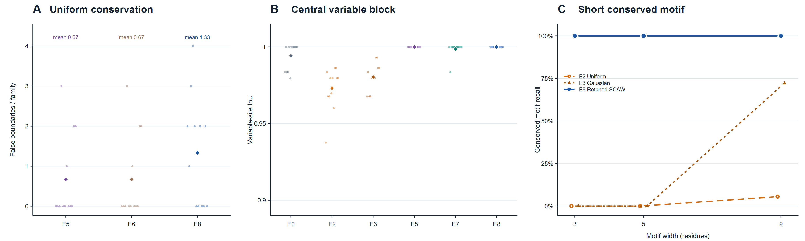
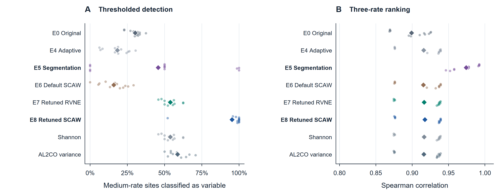
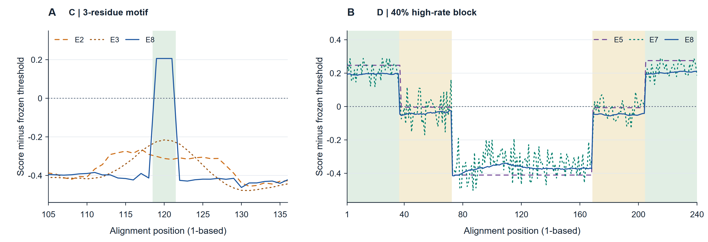
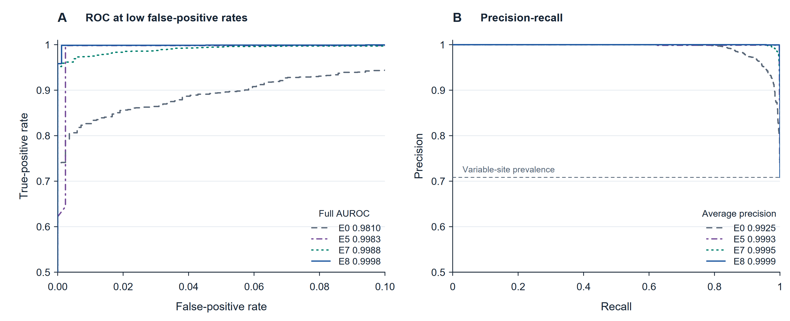
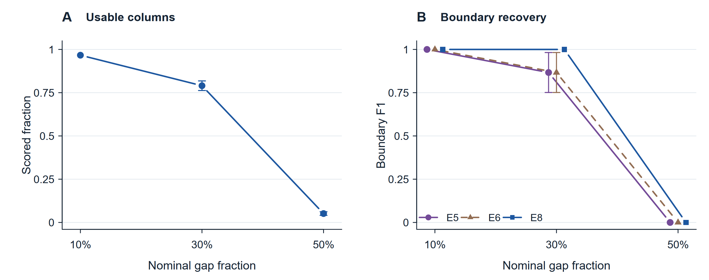

# RVNE 补充测试与消融分析

补充测试共 48 个合成比对。A、B、C、D 各 12 个家族，每个比对包含 50 条序列和 240 列。E0–E8 和 6 个基线使用原 benchmark 冻结的参数及各自的验证集阈值。补充数据无模拟缺口，全部列均可评分。统计以家族为单位等权平均，每个参数水平有 4 个独立种子。

**D 型最能区分方法。** 在同一套重调 RVNE 底层分数上，E8 将中等突变率位点的召回从 E7 的 **53.9%** 提高至 **95.3%**。E5 的三档排序最佳，Spearman 为 **0.974**。A 型暴露了过度分段，E8 的位点误报率为 **0%**，却在 **7/12** 个家族中产生了虚假边界。

## A/B/C 的位点与边界表现

| 方法 | A 可变位点误报率 | A 平均假边界数 | B 可变位点 IoU | B 边界 F1 | C motif 召回 | C 边界 F1 |
| --- | ---: | ---: | ---: | ---: | ---: | ---: |
| E0 原始 RVNE | 0.49% | — | 0.994 | — | 100.0% | — |
| E2 均匀平滑 | 0.00% | — | 0.973 | — | 1.9% | — |
| E3 高斯平滑 | 0.00% | — | 0.980 | — | 24.1% | — |
| E5 仅分段 | 0.00% | 0.67 | 1.000 | 1.000 | 100.0% | 0.983 |
| E6 默认 SCAW | 0.52% | 0.67 | 1.000 | 1.000 | 100.0% | 0.983 |
| E7 重调 RVNE | 0.14% | — | 0.999 | — | 100.0% | — |
| E8 重调 SCAW | 0.00% | 1.33 | 1.000 | 1.000 | 100.0% | 1.000 |
| Shannon | 0.14% | — | 0.999 | — | 100.0% | — |

- **A 全保守。** 真值只有一类，AUROC 和 AUPRC 未定义。位点误报率与假边界数衡量两种不同的错误。E8 在分段时沿局部得分变化切出了额外边界，但这些变化没有让位点分数越过分类阈值。
- **B 中央可变块。** 25%、40%、60% 三档下，E5、E6 和 E8 的位点 IoU 与边界 F1 均为 1.000。E7 和 Shannon 的可变位点召回也都是 100%。简单的保守/可变块可以验证端点定位，区分整体分类能力时容易遇到满分效应。
- **C 短保守 motif。** E2 和 E3 在冻结阈值下对 3、5 残基 motif 的召回均为 0%。3 残基案例显示，固定窗口平滑压低了 motif 的得分峰值。E0、E7、E8 和 Shannon 在这批无缺口数据中都找回全部 motif 位点。E8 额外给出边界，平均边界 F1 为 1.000，E5 和 E6 均为 0.983。



**图 1。** 小点代表单个家族，实心菱形代表均值。C 面板每个点平均 4 个家族，横向微移用于显示重叠点。[矢量 PDF](figures/fig01_patterns_abc.pdf)

## D 型的三档排序与阈值分类

| 方法 | Spearman | 可变位点召回 | 中等突变率召回 | 低 vs 中 AUROC | 中 vs 高 AUROC | 边界 F1 |
| --- | ---: | ---: | ---: | ---: | ---: | ---: |
| E0 原始 RVNE | 0.8991 | 70.6% | 30.3% | 0.9554 | 0.9959 | — |
| E4 仅自适应窗口 | 0.9158 | 65.7% | 18.4% | 0.9968 | 0.9997 | — |
| E5 仅分段 | **0.9743** | 77.6% | 45.7% | 0.9968 | 1.0000 | 1.000 |
| E6 默认 SCAW | 0.9154 | 64.9% | 15.9% | 0.9958 | 0.9997 | 1.000 |
| E7 重调 RVNE | 0.9165 | 80.5% | 53.9% | 0.9963 | 0.9996 | — |
| E8 重调 SCAW | 0.9175 | **98.8%** | **95.3%** | 0.9989 | 1.0000 | 1.000 |
| Shannon | 0.9165 | 80.5% | 53.9% | 0.9963 | 0.9996 | — |
| AL2CO variance | 0.9161 | 82.7% | 58.7% | 0.9960 | 0.9995 | — |

D 型的三档突变率为 0.06、0.32、1.00。原二分类真值把中档和高档都标为可变。相邻两档 AUROC 用较低突变率作正类，衡量较保守位点是否排在前面。

- **阈值分类的提升集中在中档。** E7 和 E8 的高突变率召回均为 100%。E8 在 12/12 个家族中提升了整体可变位点召回，平均增加 **18.2 个百分点**。按高突变率块占比在各层内重采样家族，得到描述性 95% bootstrap 区间 **[16.2, 19.8]** 个百分点。中档召回的增幅为 **41.4 个百分点**，区间 **[33.6, 46.8]**。区间基于这 12 个模拟家族，各水平只有 4 个家族。
- **分段准确与分类准确可以分离。** E5、E6、E8 的边界 F1 都是 1.000。边界匹配容许 ±2 列，仅要求找准变点。E6 仍把大多数中等突变率位点判为保守，其可变位点召回比仅自适应的 E4 平均低 0.9 个百分点。E7 和 E8 使用同一套底层分数，其差值反映整个上下文处理及各自阈值的共同表现。
- **排序结果受真值形状影响。** E5 在 12/12 个家族的 Spearman 均高于 E8，平均高 0.0568。E5 对段内给同一分数，与 D 型段内突变率恒定的真值相符。E8 在相邻档位仍有接近 1 的 AUROC。



**图 2。** 每行有 12 个家族，菱形表示均值。图左用固定阈值衡量中档召回，图右衡量三档排序。 [矢量 PDF](figures/fig02_pattern_d_ablation.pdf)



**图 3。** 展示两组配置各自的第一个种子，C 型 3 残基配置的 50124 和 D 型高突变率块占 40% 配置的 50140。绿底、黄底、白底依次表示低、中、高突变率。纵轴为得分减去该方法自己的验证阈值，零线以下判为可变。 [矢量 PDF](figures/fig03_position_profiles.pdf)



**图 4。** 把 D 型 12 个家族的 2,880 个位点合并绘制，以可变位点为正类，按负保守分数排序。ROC 面板放大假阳性率 0–10% 的区段，图例给出整条曲线的 AUROC。PR 图用阶梯曲线，AP 为不插值的平均精确率，虚线为可变位点占比 0.708。合并曲线的数值与逐家族汇总采用不同聚合口径，且 PR 的正类方向不同。 [矢量 PDF](figures/fig04_pattern_d_roc_pr.pdf)

## 与原留出集及缺口实验对照

| 方法 | 原留出集 Spearman | AUROC | AUPRC（保守为正类） | 边界 F1 |
| --- | ---: | ---: | ---: | ---: |
| E0 原始 RVNE | 0.812 | 0.9802 | 0.9530 | — |
| E5 仅分段 | **0.859** | 0.9921 | 0.9666 | 0.983 |
| E7 重调 RVNE | 0.829 | 0.9927 | 0.9835 | — |
| E8 重调 SCAW | 0.846 | **0.9996** | **0.9990** | **1.000** |

原核心留出集共有 32 个家族，其中 Spearman、AUROC、AUPRC 各有 24 个家族可计算，边界 F1 使用 20 个有明确真值边界的家族。原留出集同样显示 E5 的秩相关高于 E8。缺口 sweep 里，50% 名义缺口条件下仅 **5.1%** 的列可评分，E8 的边界 F1 和保守区 IoU 均为 **0**。30% 名义缺口下，E8 的边界 F1 仍为 1.000，保守区 IoU 已降到 0.119。边界定位、分段类别和有效覆盖率需要一起看。



**图 5。** 每个缺口水平 3 个家族，点为均值，须为样本标准差并限制在指标的 0–1 范围。边界面板的横向微移用于显示重叠点。各方法使用相同的可评分位点掩码。 [矢量 PDF](figures/fig05_reference_gap_sweep.pdf)

## 数据表与复现

- [A/B/C/D 全方法分组汇总](tables/table_supplemental.tsv) · [按发散度、块占比或 motif 长度汇总](tables/table_by_setting.tsv) · [D 型逐家族配对差值统计](tables/table_d_paired.tsv)
- [原核心留出集汇总](tables/table_reference_core.tsv) · [原缺口 sweep 汇总](tables/table_reference_gap.tsv)
- [图 3 逐列作图数据](tables/figure_position_profiles.tsv) · [图 4 ROC/PR 坐标](tables/figure_d_curves.tsv)

逐家族数据来自 [补充实验](../rvne/results/supplemental_run/families.tsv)、[原核心留出集](../rvne/results/reference_run/test_families.tsv) 和 [原 sweep](../rvne/results/reference_run/sweep_families.tsv)。`n` 是有定义的家族数，`sd` 是家族间样本标准差，空值代表该指标在所示组无可用样本。B 的 `variable_site_iou` 用判为可变的位点掩码，缺口一节的 `region_iou` 用分段均值阈值化得到保守区，二者分别对应位点与区段输出。

从仓库根目录运行以下命令。Python 使用 `code/rvne/requirements.txt`，R 绘图使用 base R 和 Cairo。图 3、4 从对齐与真值文件重算位点分数，方法参数和阈值仍来自同一份 `parameters.json`。若数据目录尚未生成，可按 [补充实验说明](../data_generation/README.md) 生成 A/B/C 和 D 数据，并将其放在 `code/data_generation/datasets/patterns_abc` 与 `patterns_d`。

```powershell
$env:PYTHONPATH = 'code;code/rvne/src'
$env:OPENBLAS_NUM_THREADS = '1'
python code/output/prepare_analysis.py
Rscript --vanilla code/output/plot_analysis.R
```

## 绘图参考

- 图 4 的低假阳性率 ROC 面板参考 Capra & Singh 对窗口保守性方法的 ROC 对照。这里使用本项目 D 型数据。 [Capra & Singh, Bioinformatics, 2007, figs. 2–3](https://doi.org/10.1093/bioinformatics/btm270)
- 图 3 的横轴按 MSA 列对齐，并用背景色标出真值区段。设计参考 MSAViewer 的逐列保守性轨道。 [Yachdav et al., Bioinformatics, 2016, fig. 1](https://doi.org/10.1093/bioinformatics/btw474)
