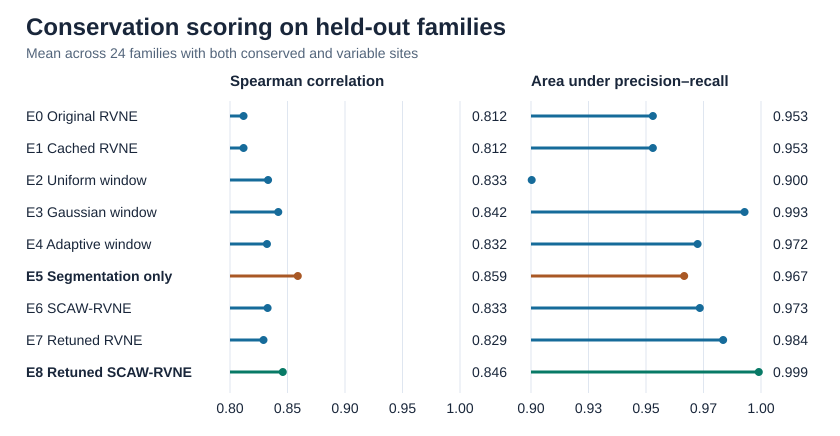
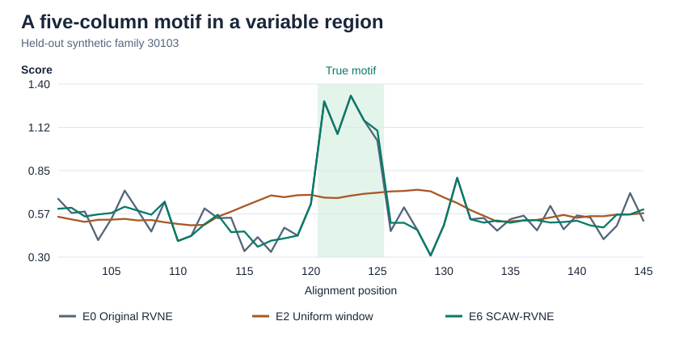

# Synthetic benchmark results

The reference run used Python 3.13.5, NumPy 2.5.2 and one OpenBLAS thread. It includes 32 core test families and 63 additional one-factor sweep families. The [protocol](benchmark_protocol.md) specifies how each metric is defined. The [reference run](../results/reference_run/) contains per-family metrics, aggregates, the entire tuning grid, frozen parameters and timing samples summarized across repeats.

## Held-out ablations

Values are means across eligible families. There were 24 mixed-truth families for rank and classification curve metrics. ClustalW consensus was constant in five of those families at the benchmark's ranking precision, so its Spearman mean uses 19 families. Sensitivity and specificity each include 28 families with the corresponding class. The segment-boundary metrics use 20 abrupt families. The underlying tables give metric-specific counts and standard deviations.

| Method | Spearman | AUROC | AUPRC | Sensitivity | Specificity | Boundary F1 | Conserved-region IoU |
| --- | ---: | ---: | ---: | ---: | ---: | ---: | ---: |
| E0 Original RVNE | 0.812 | 0.980 | 0.953 | 0.972 | 0.888 | | |
| E1 Cached RVNE | 0.812 | 0.980 | 0.953 | 0.972 | 0.888 | | |
| E2 Uniform window | 0.833 | 0.987 | 0.900 | 0.831 | 0.898 | | |
| E3 Gaussian window | 0.842 | 0.997 | 0.993 | 0.835 | 0.905 | | |
| E4 Adaptive window | 0.832 | 0.993 | 0.972 | 0.992 | 0.893 | | |
| E5 Segmentation only | **0.859** | 0.992 | 0.967 | 0.987 | 0.923 | 0.983 | 0.907 |
| E6 SCAW-RVNE | 0.833 | 0.993 | 0.973 | **0.994** | 0.896 | 0.983 | 0.872 |
| E7 Retuned RVNE | 0.829 | 0.993 | 0.984 | 0.981 | 0.929 | | |
| E8 Retuned SCAW-RVNE | 0.846 | **1.000** | **0.999** | 0.981 | **0.949** | **1.000** | **0.937** |
| Shannon | 0.829 | 0.993 | 0.984 | 0.981 | 0.929 | | |
| KL | 0.793 | 0.966 | 0.921 | 0.965 | 0.888 | | |
| Jensen–Shannon | 0.819 | 0.988 | 0.970 | 0.984 | 0.891 | | |
| BLOSUM62 severity | 0.818 | 0.990 | 0.979 | 0.982 | 0.877 | | |
| ClustalW consensus | 0.385 | 0.606 | 0.487 | 0.212 | **0.997** | | |
| AL2CO variance | 0.827 | 0.991 | 0.982 | 0.981 | 0.941 | | |

E5 had the highest mean Spearman, 0.859 ± 0.196 across eligible families. Its piecewise-constant estimates kept scores tied within regions with constant true rates. E6 and E4 gave nearly the same overall rank performance. The segmentation constraint kept windows inside the fitted regimes and reduced the fraction of single-column windows from 27.5% to 25.3% with the default adaptive objective. The window objective selected several widths, and the average gain from the constraint was modest.

E8 had a mean AUPRC of 0.999 ± 0.003 and the highest specificity among E0–E8. Its advantage over E6 combines retuned RVNE with retuned window and segmentation settings. Gaussian smoothing achieved AUPRC 0.993 and is a strong comparator. The boundary F1 of 1.000 for E8 reflects the clean separation between abrupt core regimes. Performance declined in the sensitivity sweep, where E8 boundary F1 averaged 0.935 and E5 averaged 0.892.

The unweighted AL2CO variance index achieved similar position-level results to Shannon. The four-level ClustalW consensus rule achieved specificity of 0.997 at sensitivity of 0.212. At the validation-selected threshold of 1, it calls sites conserved only when all observed symbols fit a published consensus group or are the same canonical residue.

Uniform averaging reduced short-motif contrast. The three-column motif sweeps had E8 F1 and IoU of 1.000 at all three seeds. Under 50% nominal gaps, only about 4–6% of columns survived the paper cutoff and E8 boundary F1 and conserved-region IoU were both zero for all three seeds. The near-perfect AUROC on those surviving columns should be read with that low coverage.

## Parameter selection

The best training configuration was (0, 0, 0), equivalent to one minus Shannon entropy. Validation selected (0, 0.1, 0) from 20 retained or refined candidates. Mean validation Spearman was 0.829 versus 0.812 for the paper setting (0.8, 0.8, 0.8). Across regimes, the best tested observed similarity ranged from 0.05 to 0.4. The widest scenario-level Spearman difference between its best configuration and the global setting was below 0.001. E7 and Shannon were indistinguishable to three decimals on held-out metrics. These results support treating the simulator as a test of mutation-rate estimation. It provides little evidence that an informative background or strong similarity improves that objective.

Validation selected β=6, minimum segment length 2, an unbounded maximum, λ=4 and radii 0, 1, 2, 4, 8 and 16. On core test data the average family median window was 28.1 columns for E8. The default E6 median was 6.3 columns. The larger λ and radius affect how aggressively E8 smooths within regimes. The separate grids and per-regime means are in the reference run.

## Numerical equivalence and cost

Timing medians use four runs. At 50 sequences × 500 columns, the scoring stage took 77.3 ms reference and 7.99 ms cached, a 9.68× gain. At 5,000 columns the scoring stage took 709 ms reference and 71.7 ms cached, a 9.88× gain. At that length, profile preparation took 232 ms and unbounded segmentation plus adaptive smoothing took 361 ms. These stages limit end-to-end speedup. The batched trace path used 2.69 MB peak traced allocation at 5,000 columns, versus 0.107 MB for the streaming reference. The 1,331-point grid at 5,000 columns took 0.969 s and 57.4 MB traced peak, including its full score array. Timings vary with Python, LAPACK, hardware and parallel workload.

Across all runtime families, the maximum reference–cached deviation was 2.89×10⁻¹⁵. The corresponding mean deviation was 4.85×10⁻¹⁶, with tied-rank Spearman 1.000. Separate unit tests cover parameter endpoints, empty usable sets and the grid formulation.

## Scope of evidence

Synthetic family structure is simpler than true protein evolution. Both methods and boundaries were evaluated on already aligned sequences. Test families share the simulator's mutation mechanism and vary seeds and controls. Real globular family validation and reproduction of the original CSA catalytic-site AUC remain open. The tables support comparisons on these synthetic targets.
